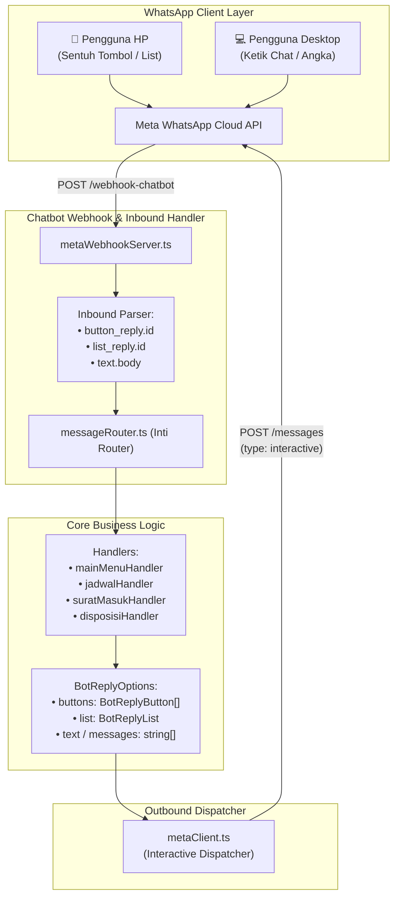

# 📑 Rencana Implementasi: Fitur Tombol & List Menu Interaktif Meta WhatsApp Cloud API

Dokumen ini merangkum spesifikasi arsitektur teknis, desain antarmuka, strategi *hybrid interaction*, serta tahapan pengerjaan untuk mengimplementasikan **Pesan Interaktif (Quick Reply Buttons & Interactive List Menus)** pada Chatbot WhatsApp Administrasi Protokol Kemnaker.

---

## 🎯 1. Ringkasan & Sasaran Implementasi

1. **Pengalaman Pengguna (*Modern UI/UX*)**: Pengguna WhatsApp di ponsel dapat mengakses layanan dan mengonfirmasi data hanya dengan menyentuh tombol (*one-tap*), tanpa perlu mengetik manual.
2. **Dukungan Penuh *Hybrid Interaction***: Seluruh fitur tetap dapat diakses dengan mengetik teks perintah atau angka melalui keyboard WhatsApp (100% kompatibel untuk pengguna WhatsApp Web/Desktop PC).
3. **Pemanfaatan Standar Resmi Meta Cloud API**: Menggunakan skema JSON `type: "interactive"` resmi dari Meta Graph API (v21.0).
4. **Isolasi Penuh dari Layanan AI**: Tidak mengubah kontrak data `gatsu-ai-service` maupun database PostgreSQL yang telah tersinkronisasi.

---

## 🏛️ 2. Arsitektur Komponen Teknis

---

## 🔘 3. Rincian Fitur & Titik Penempatan Tombol (*Touchpoints*)

### 1. Menu Utama / Salam Pembuka
* **Tipe Pesan**: *Interactive List Menu*
* **Tombol Pemicu**: `[ 📋 Buka Menu Layanan ]`
* **Daftar Pilihan (*List Bottom-Sheet*)**:
  * **Bagian 1: Pelayanan & Administrasi**
    * `1. Registrasi Surat Masuk` — Unggah berkas naskah dinas baru (PDF/Foto).
    * `2. Input Lembar Disposisi` — Catat arahan disposisi pimpinan.
    * `3. Agenda Jadwal Pimpinan` — Cek agenda kegiatan Menaker/Wamen.
  * **Bagian 2: Informasi & Riwayat**
    * `4. Riwayat Surat Masuk` — Daftar surat yang baru saja didaftarkan.
    * `5. Cari Surat & Agenda` — Pencarian cerdas perihal, instansi, atau tanggal.
    * `6. Bantuan & Panduan` — Petunjuk format dan aturan bot.
* **Padanan Ketik**: Pengguna tetap bisa mengetik angka `1` s.d. `6` atau kalimat natural (misal: *"jadwal hari ini"*, *"surat masuk"*).

---

### 2. Menu Jadwal & Agenda Pimpinan
* **Tipe Pesan**: *Quick Reply Buttons* (Maksimal 3 Tombol)
* **Pilihan Tombol**:
  1. `[ 📅 Hari Ini ]` (ID: `JADWAL_HARI_INI` / `1`)
  2. `[ 📆 Besok ]` (ID: `JADWAL_BESOK` / `2`)
  3. `[ 🔍 Cari Jadwal ]` (ID: `JADWAL_CARI` / `3`)
* **Padanan Ketik**: Mengetik `1`, `2`, `hari ini`, `besok`, atau `lusa`.

---

### 3. Alur Registrasi Surat Masuk (Review & Konfirmasi)
* **Titik A: Pemilihan Kategori Surat Dinas**
  * Tipe: *Interactive List Menu* (`[ 📑 Pilih Kategori Surat ]`)
  * Pilihan: `UND (Undangan)`, `PH (Permohonan Hadir)`, `UNR (Pernikahan)`, `WR (Wawancara)`, `AU (Audiensi)`, `TAP (Video Ucapan)`, `LP (Lainnya)`.
* **Titik B: Review Hasil Ekstraksi AI**
  * Tipe: *Quick Reply Buttons*
  * Pilihan:
    1. `[ ✅ Simpan Surat ]` (ID: `SURAT_CONFIRM_SAVE` / `SIMPAN`)
    2. `[ ✏️ Koreksi Data ]` (ID: `SURAT_KOREKSI` / `KOREKSI`)
    3. `[ ❌ Batalkan ]` (ID: `SURAT_CANCEL` / `BATAL`)
* **Titik C: Konfirmasi Perihal Rekomendasi AI**
  * Tipe: *Quick Reply Buttons*
  * Pilihan:
    1. `[ ✅ Setujui Rumusan ]` (ID: `PERIHAL_CONFIRM_AI` / `YA`)
    2. `[ ✍️ Ketik Sendiri ]` (ID: `PERIHAL_MANUAL` / `MANUAL`)

---

### 4. Alur Lembar Disposisi (Review & Konfirmasi)
* **Tipe Pesan**: *Quick Reply Buttons*
* **Pilihan Tombol**:
  1. `[ ✅ Simpan Disposisi ]` (ID: `DISPOSISI_CONFIRM_SAVE` / `SIMPAN`)
  2. `[ ✏️ Edit Isian ]` (ID: `DISPOSISI_EDIT` / `KOREKSI`)
  3. `[ ❌ Batalkan ]` (ID: `DISPOSISI_CANCEL` / `BATAL`)

---

## 🛠️ 4. Rincian Modifikasi File & Kode

| No | File Sasaran | Jenis Perubahan | Deskripsi Teknis |
|---|---|---|---|
| **1** | `src/bot/types.ts` | Penyesuaian Tipe | Melengkapi interface `BotReplyButton`, `BotReplyList`, dan `BotReplyOptions` agar mendukung *header*, *body*, *footer*, dan *payload ID*. |
| **2** | `src/bot/providers/metaClient.ts` | Fitur Baru | Menambahkan *engine dispatcher* pesan interaktif:  • `sendInteractiveButtons(...)` • `sendInteractiveList(...)` • Mendeteksi apakah `response` memiliki tombol/list, jika ya otomatis memanggil API interaktif Meta. |
| **3** | `src/bot/providers/metaWebhookServer.ts` | Verifikasi & Normalisasi | Memastikan `button_reply.id` dan `list_reply.id` dinormalisasi dengan benar sebelum diteruskan ke `MessageRouter`. |
| **4** | `src/bot/handlers/mainMenuHandler.ts` | UI Upgrade | Menambahkan opsi `list` menu interaktif pada balasan menu utama. |
| **5** | `src/bot/handlers/jadwalHandler.ts` | UI Upgrade | Menambahkan `buttons` Quick Reply pada menu navigasi jadwal. |
| **6** | `src/bot/handlers/suratMasukHandler.ts` | UI Upgrade | Menambahkan tombol konfirmasi review surat dan pemilihan perihal rekomendasi AI. |
| **7** | `src/bot/handlers/disposisiHandler.ts` | UI Upgrade | Menambahkan tombol simpan/koreksi/batal pada lembar disposisi. |

---

## 🔒 5. Jaminan Keamanan & *Backward Compatibility*

1. **Tanpa Duplikasi Logika**: Input ID dari tombol (misal `CMD_SIMPAN`) langsung dialihkan ke teks `SIMPAN` yang sudah dikenali oleh *handler*. Tidak perlu menulis ulang logika penyimpanan database!
2. **Fallback Otomatis**: Jika pesan dibuka di perangkat yang belum mendukung tombol (atau terjadi pembatasan di WhatsApp Web), teks petunjuk manual (misal: *"Ketik SIMPAN atau sentuh tombol di bawah"*) tetap disertakan di dalam *body text*.
3. **No Breaking Changes**: Transisi ke `gatsu-ai-service` dan koneksi database PostgreSQL tidak tersentuh sama sekali.

---

## 🚀 6. Tahapan Eksekusi Bertahap (Lokal Terlebih Dahulu)

- [ ] **Tahap 1**: Implementasi pengirim interaktif (`sendInteractiveButtons` & `sendInteractiveList`) di `src/bot/providers/metaClient.ts`.
- [ ] **Tahap 2**: Penambahan tombol interaktif pada Menu Utama & Menu Jadwal.
- [ ] **Tahap 3**: Penambahan tombol interaktif pada Alur Registrasi Surat Masuk & Lembar Disposisi.
- [ ] **Tahap 4**: Kompilasi (`npm run build`) dan pengujian simulator lokal / unit test.
- [ ] **Tahap 5**: Presentasi ringkasan perubahan kepada pengguna untuk diperiksa (tanpa melakukan `git push`).

